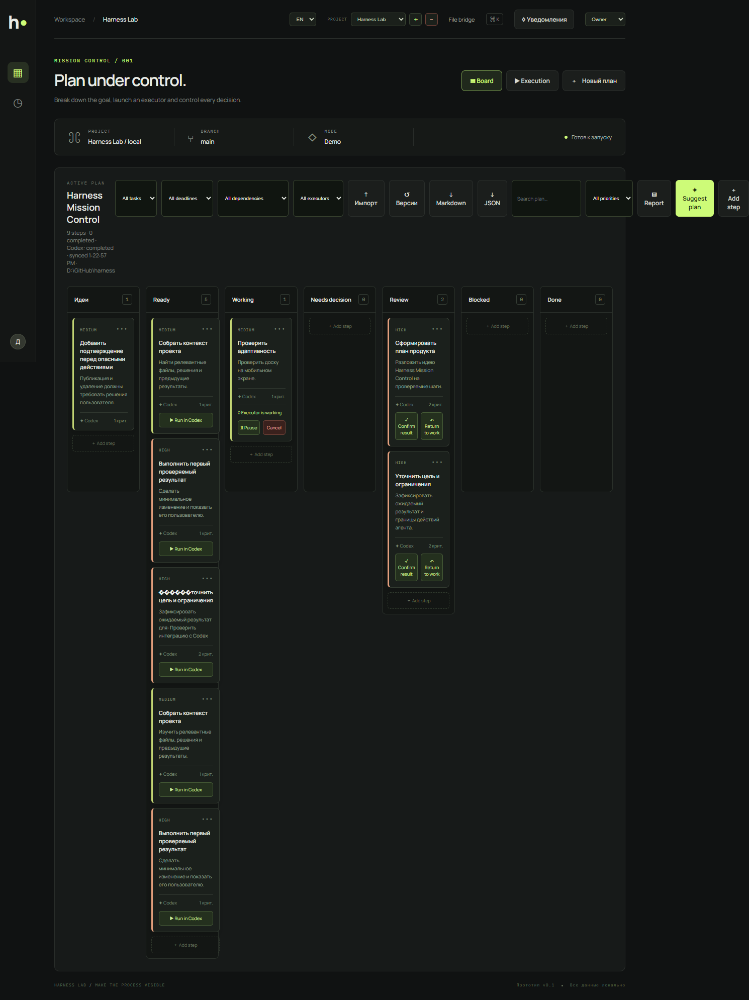

# Harness Lab

Harness Lab is a local mission-control workspace for planning, executing, and reviewing work across multiple software projects. It combines a Kanban board with a file-based bridge that lets Codex, IDEs, terminals, scripts, and human contributors collaborate without a mandatory AI API or cloud service.

All project state is stored locally. Harness does not call external AI APIs and does not require API keys.

## Interface preview



## Quick start on Windows

Requirements:

- Node.js 18 or newer.
- PowerShell.
- A project folder that Harness can read and write.

From PowerShell:

```powershell
Set-Location D:\GitHub\harness
npm start
```

Open the URL printed in the terminal, normally `http://localhost:4173`. If the port is busy, Harness tries the next available port through 4193. Stop the server with `Ctrl+C`.

Run the validation suite with:

```powershell
npm test
```

The project uses Windows-compatible Node commands and does not require `.sh` scripts.

## Desktop application

Harness Lab can run as a standalone desktop application without opening a browser or keeping a terminal open. The Electron shell starts the local server, opens the workspace in its own window, and stores application data in the current user's profile.

For local development:

```powershell
npm install
npm run desktop
```

To create an installer and a portable executable:

```powershell
npm run package:desktop
```

Platform-specific packages can be created with:

```powershell
npm run package:desktop:win   # Windows installer and portable .exe
npm run package:desktop:linux # Linux AppImage and .deb
npm run package:desktop:mac   # macOS .dmg and .zip
```

The output is written to `dist/`. The GitHub release workflow builds Windows, Linux, and macOS packages on native runners and publishes them together with the PWA archive.

## Build a PWA release

The repository includes a Windows PowerShell packager and a GitHub Actions release workflow.

To create the same archive locally:

```powershell
.\scripts\package-pwa.ps1 -Version 0.1.0
```

The archive is written to `release/harness-lab-pwa-v0.1.0.zip`. It contains the local Node server, the installable PWA shell, the manifest, service worker, application files, license, and release instructions. Local project data, `.harness` state, development artifacts, and secrets are excluded.

To publish automatically, push a version tag:

```powershell
git tag v0.1.0
git push origin v0.1.0
```

The `Release Harness Lab PWA` workflow runs `npm test`, packages the PWA on Windows, uploads a workflow artifact, and creates a GitHub Release with the ZIP attached. It can also be started manually from the Actions tab with a version input. Re-running a version whose GitHub Release already exists updates that release and replaces matching asset names instead of failing on `gh release create`. The workflow uses the repository's `GITHUB_TOKEN`; no AI or external service API is required.

## WebStorm, IntelliJ, and VS Code

Open `D:\GitHub\harness` as a project and start the application with an npm configuration:

1. Select `package.json` from the Harness project.
2. Set the command to `run`.
3. Set the script to `start`.
4. Run the configuration and open the URL shown in the terminal.

The same file protocol works from WebStorm, IntelliJ IDEA, VS Code, Cursor, a terminal, or any custom tool. Open the target project folder in the tool, read `.harness/current-task.md`, and write the result back to the `.harness` files.

## Main capabilities

- Multiple registered projects with an isolated `.harness` directory for each project.
- Kanban planning with drag-and-drop, dependencies, cycle detection, priorities, deadlines, estimates, roles, comments, mentions, history, and saved views.
- Hierarchical global tasks with expandable subtasks distributed across status columns.
- LLM plan bridge: child tasks are written into `current-task.md` and plans returned by an executor are imported back into the board.
- Per-card execution mode: `ИИ берет сам` for automatic pickup or `По указанию пользователя`, including drag-to-`В работе` launch.
- Imported plan items use stable `[plan:<id>]` keys, so executor renames update existing subtasks instead of creating duplicates; global status is derived from child statuses.
- Executor plans support both Markdown checklists and fenced JSON (`{"plan":[...]}`); `[x]` or `status: "done"` completes the matching subtask, and imports show a confirmation preview before applying changes.
- Plan imports use a confirmation dialog, and task execution uses a 30-minute claim lease to prevent two agents from running the same card concurrently.
- Local planning suggestions from the built-in planner; no external AI API is used.
- Codex, IDE, PowerShell, CLI/script, and human executors using one local contract.
- Task pause, resume, cancel, retry, review, and completion gates.
- Completion validation that requires a report and acceptance criteria.
- Executor queue stored in `.harness/queue.json`, so a new task cannot overwrite an active task.
- PowerShell execution with explicit confirmation, dry-run preview, a 30-second timeout, project working directory, and a restricted environment allowlist.
- Shell-free CLI execution for approved `git`, `npm`, and `node` commands.
- Built-in adapters for `git status`, `npm test`, `npm run lint`, and `npm run build`.
- Markdown, JSON, CSV, GitHub Issues, and Trello export imports.
- Plan versioning, backups, optimistic concurrency checks, and rollback.
- Git branch and project health visibility.
- English and Russian interface localization with browser-persisted language selection.
- PWA shell, offline static assets, and optional local browser notifications.
- JSON and Markdown plan/event export.
- Windows smoke tests and Playwright browser verification.

## Mission Control workflow

1. Start Harness and select an existing project or add a project folder by absolute Windows path.
2. Harness creates `.harness` inside the selected project without deleting project files.
3. Create or import a plan and assign each step to an executor.
4. Start a task from the board.
5. Let the selected tool work in the project folder.
6. Review the report, changed files, events, criteria, and task history.
7. Confirm the result or return the task to work.

High-priority tasks can require an approval checkpoint before execution. Dependencies prevent a task from starting while required cards are unfinished.

## File-based collaboration protocol

Each registered project contains:

```text
.harness/
  project.json       project metadata
  plan.json          Kanban columns, cards, and plan revision
  current-task.md    task currently assigned to an executor
  status.json        current executor status and timestamps
  events.jsonl       append-only activity stream
  context.md         optional project context
  queue.json         waiting tasks
  requests/          task and control requests
  reports/
    latest.md        latest executor report
  backups/           recoverable file snapshots
```

An executor should:

1. Read `.harness/current-task.md` before starting.
2. Update `.harness/status.json` while working.
3. Append meaningful events to `.harness/events.jsonl`.
4. Write the final result to `.harness/reports/latest.md`.
5. Leave the task failed or blocked when required checks did not pass.

The protocol is deliberately tool-agnostic. Harness does not need to control an IDE window or a Codex process directly; it observes the shared files and updates the board.

## Executors and local commands

### Codex and IDEs

Assign a card to `Codex` or `IDE` when the external tool should consume the file request and report through `.harness`. This works with WebStorm, IntelliJ IDEA, VS Code, Cursor, Codex, or a custom agent.

### PowerShell

Assign `PowerShell`, enter a command, and optionally enable dry-run. A real execution requires an explicit confirmation in the UI. Harness runs PowerShell in the registered project directory and records stdout, stderr, exit code, status, and timestamps in the project report and event stream.

### CLI and adapters

Assign `CLI / script` and either enter a command or select an adapter:

- `Git status`
- `npm test`
- `npm run lint`
- `npm run build`

The command is executed without shell interpolation. Approved executables are limited to PowerShell, `npm`, `node`, and `git`; the working directory is the registered project directory and only a small environment allowlist is passed to the process.

### Queue

When an executor is busy, a new task is written to `.harness/queue.json` instead of replacing `current-task.md`.

```text
GET  /api/projects/<project-id>/queue
POST /api/projects/<project-id>/queue/next
```

An executor can inspect the queue and claim the next task after the active task reaches a terminal state.

## Import and export

Use the `Import` button on the board to import:

- Markdown checklist items such as `- [ ] Implement login`.
- JSON plans or card arrays.
- CSV files with `title`, `description`, `priority`, `status`, and `executor` columns.
- GitHub Issues exports with `title`, `body`, `state`, and optional `html_url`.
- Trello exports with `name`, `desc`, `closed`, and optional `shortUrl`.

Imported cards retain their source metadata and are recorded as an import event. Plans and recent events can be downloaded as JSON or Markdown.

## Local API overview

The local Node server exposes project-scoped endpoints including:

```text
GET  /api/projects
POST /api/projects
GET  /api/projects/<id>/state
PUT  /api/projects/<id>/plan
POST /api/projects/<id>/task
POST /api/projects/<id>/command
GET  /api/projects/<id>/queue
POST /api/projects/<id>/queue/next
GET  /api/projects/<id>/plan/versions
POST /api/projects/<id>/plan/rollback
POST /api/projects/<id>/suggest
```

The planner endpoint is local and deterministic. It does not proxy prompts to an AI provider.

## Security and safety model

- No external AI API calls or API keys.
- No automatic command execution: local commands require an explicit UI confirmation unless they are only being previewed.
- Dry-run is available before execution.
- CLI executable allowlist and shell-free argument execution.
- Project working-directory restriction.
- Restricted environment variables.
- 30-second local command timeout and bounded output buffer.
- Project removal only removes the project from the Harness registry; it does not delete the project folder.
- Plan backups and optimistic concurrency checks protect against accidental overwrites.

Harness is a local workflow guard, not a full operating-system sandbox. Do not register untrusted project folders or approve commands you have not reviewed.

## Development checks

```powershell
npm run check
npm run smoke
npm test
```

`npm test` starts an isolated server with a temporary workspace and validates server APIs, file recovery, templates, plan versioning, executor contracts, queue dispatch, PowerShell execution, CLI and npm adapter execution, localization, imports, and the local protocol. It removes the temporary workspace afterward without changing your registered projects or `.harness` files. Regression checks cover paused-task preservation, stale edits after rollback, and private-file access. `npm run smoke` targets a running server (`HARNESS_URL`, default `http://localhost:4173`); use a disposable workspace because it exercises write operations. Browser flows are verified separately with Playwright.

Карточки могут автоматически захватываться исполнителем или запускаться только по указанию пользователя. Для долгих задач Harness показывает агента и срок аренды захвата, продлевает аренду heartbeat-запросами, пишет захват/освобождение в аудит и позволяет освободить рабочую карточку прямо на доске. При создании проекта доступны шаблоны разработки, дефекта, исследования, релиза, миграции и проверки безопасности.

Если исполнитель уже занят, новые задачи попадают в блок «Входящие для ИИ». При ручном запуске очереди сначала выбирается высокий приоритет, затем ближайший дедлайн и время постановки. Занятая задача не запускается повторно, пока текущий исполнитель не завершён.

Очередь может обслуживаться встроенным worker без действий пользователя: при `HARNESS_AUTO_DISPATCH=true` сервер периодически проверяет проекты и передаёт первую задачу свободному исполнителю через файловый мост. Для детерминированных тестов worker отключается `HARNESS_AUTO_DISPATCH=false`; интервал задаётся `HARNESS_AUTO_DISPATCH_INTERVAL_MS`.

Worker добавлен в Приоритет 8 `ROADMAP.md`. Интеграционный smoke-контур запускается с worker, отключённым для стабильности существующих API-тестов; состояние worker доступно в `GET /api/projects/<id>/state`.

Для запуска доступны три политики: «по указанию пользователя», «ИИ предлагает, пользователь подтверждает» и «ИИ берет сам». Сервер дополнительно ограничивает полностью автономный запуск локальных команд готовыми адаптерами; произвольные PowerShell/CLI-команды требуют явного подтверждения.

Политика задаётся для проекта: «Строго безопасный» разрешает только git-status и npm test, «Обычная разработка» разрешает все встроенные адаптеры и подтверждённые команды, «Полный ручной контроль» запрещает автономный запуск.

Политику и набор разрешённых адаптеров можно изменить после создания проекта через кнопку «⚙ Политика» на доске. Настройка сохраняется в реестре проектов и повторно проверяется сервером при каждом запуске команды.

При включённых браузерных уведомлениях Harness сообщает о зависшей задаче и проблемах файлового моста только при появлении нового предупреждения, без повторного спама на каждом обновлении.

## Product extensions

The current foundation makes several useful extensions possible without changing the local-first model:

- Git diff and changed-file review directly inside the report dialog.
- Named command profiles with per-project approval policies.
- Scheduled local checks and recurring health monitors.
- Richer executor routing based on capabilities, priority, and availability.
- Additional import mappings for Jira, Linear, Azure DevOps, and generic task exports.
- Webhooks or local folder watchers for tools that cannot call the Harness API.
- Team synchronization through an optional self-hosted shared file store.
- Audit-log filters, saved reports, and release readiness dashboards.
- Extension packages for language-specific test runners, linters, and build systems.

These extensions are intentionally compatible with the existing `.harness` protocol and do not require a hosted AI service.
